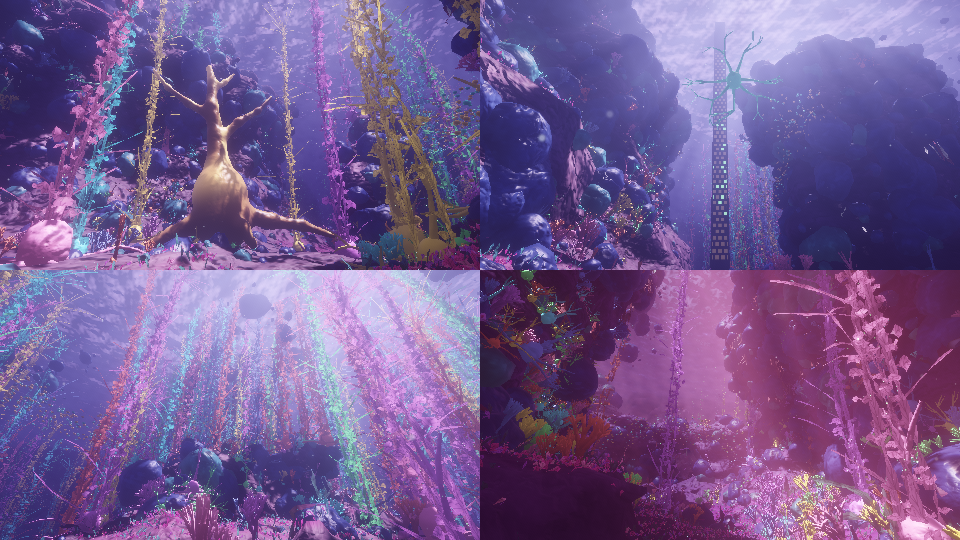

# Neuropil

**A procedural slab of cortex you can fly through, in one HTML file.**

Brainbow-coloured pyramidal neurons rise from the white matter to the pia, studded with spines. Calcium transients
flash along the dendrites, microglia wave their processes, a silicon probe hangs down from the surface, and the
audio is a spike crackle over a heartbeat. No images, models or sound files: everything is generated when the page
opens.

> **Also in this repo: [Lamina](lamina/)**, a second take that drops the ocean engine. A 2 to 4 kB genome of layers,
> cell types and growth rules grows neocortex, cerebellar cortex or hippocampus CA1, wires a circuit through it and
> runs it. One 31 kB file, WebGL 2, works on a phone. Play [`lamina/index.html`](lamina/index.html).

This is a re-skin of [Abyssal Garden](https://github.com/Noniv/abyssal-garden) by Noniv (MIT). The renderer, the
terrain generator and the scattering rules are that project's; the content, palette and sound are new.



*Low detail, software-rendered at 480×270. High detail draws four times as many spines.*

## Try it

Open [`index.html`](index.html) in Chrome or Edge on a desktop (any browser with WebGPU). It works offline.

| | |
|---|---|
| Look | Mouse |
| Fly | `W` `A` `S` `D`, `E` / `Q` up and down, `Shift` faster |
| Viewpoints | `1` to `6` |
| Menu, mute, stats | `Esc`, `M`, `H` |
| Touch | Hold to fly forward, slide to steer, second finger to go faster (experimental) |

## What became what

| Abyssal Garden | Neuropil |
|---|---|
| Kelp column | Bundle of apical dendrites with spines, oblique branches and a tuft, one Brainbow hue per neuron |
| (new) | Soma with basal dendrites at the foot of every column |
| Sparkling specks | Calcium transients: sudden rise, slow decay, mostly green |
| Sponges, coral | Small stellate, pyramidal and bitufted neurons; bushy and Purkinje-like arbors |
| Rocks, boulders, pebbles | Cell bodies with blue nuclei |
| Seabed and cliffs | Neuropil, tinted like stained tissue |
| Whale-tail sculpture | Giant golden pyramidal neuron with a pulse running up its dendrites |
| Sunken ship | Recording probe with gold sites that flash on a spike |
| Manta rays | Microglia |
| Fish schools | Vesicle swarms |
| Water surface | The pia, lit from above |
| Whale calls, bubbles | Heartbeat, spike crackle, vesicle pops |

Scale is fantasy: spines, somata and the probe are not to scale with each other.

## Build

The readable source is in [`source`](source). You need Node.js 18 or newer.

```bash
cd source
npm install
npm run build        # writes ../index.html
npm run build:dev    # writes ../dev.html with the fly-through and benchmark tools
```

Where to start: `src/world.js` (layout, neurons and meshes), `src/shaders.js` (palette and materials),
`src/audio.js` (sound).

One engine change from upstream: the terrain compute pass runs in 16 short slabs instead of one long job, so slow
GPUs are less likely to time out while loading.

## Licence

MIT, see [`LICENSE`](LICENSE). Abyssal Garden is Copyright (c) 2026 Maksymilian Dendura.
