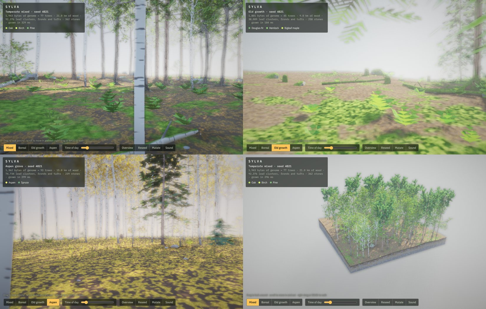

# Sylva

**A forest genome: under 2 kB of rules that grow a 64 m plot of forest, in one 50 kB HTML file.**



*Software-rendered in headless Chrome. Not yet seen on a real GPU.*

The third piece in this repo, after [Neuropil](../) and [Lamina](../lamina/). Same idea as Lamina, new rules: a
genome is a short list of species, each a row of growth numbers, plus a few numbers for the land, the air and the
forest floor. One grammar reads any genome and grows the plot. Nothing is stored: no meshes, no textures, no sound
files.

Open [`index.html`](index.html) in any browser with WebGL 2. It works offline.

## What the genome encodes

| Gene | What it does |
|---|---|
| Axis rules | Trunk, bough and twig each get a row: step length, pull toward or away from gravity, upturn at the tip, wobble, spacing between side shoots, how many per whorl, the angle they leave at, and how long they grow relative to their parent. |
| Phyllotaxis | Each new whorl is rotated from the last by the golden angle, 137.5°, so side shoots never stack. |
| Crown shape | A length profile along the trunk: long low boughs give a spruce spire, long high ones an oak dome. |
| Pipe model | Every leaf cluster adds one unit of load to all the wood beneath it. Radius is `rt × load^(1/dv)`, da Vinci's rule, so trunk taper and butt flare are computed, not drawn. |
| Bark | One of four procedural kinds: furrowed, plated, papery with lenticels, smooth. |
| Leaves | Cards with a mask worked out per pixel: broad leaves, round leaves on long stalks, needle sprays, needle fans. |
| Land | Relief, tilt, how many stones and how big, fallen logs, stumps. Stones are a noisy sphere cut by a few random planes. |
| Floor | Moss level, litter colour, ferns and grass with how wet they like it, mushrooms. |
| Air | Sun height and bearing, fog density, haze height, wind. |

Moss is not placed anywhere. It is a rule evaluated on every surface: facing up, away from the sun, low down and
damp. Stones, logs, root flares and the shaded side of trunks go green because the rule says so.

Four genomes ship, 1.4 to 1.9 kB each as JSON:

- **Temperate mixed**: oak, birch, pine over ferns and leaf litter.
- **Boreal**: spruce spires with a few birch and pine, heavy moss, low sun.
- **Old growth**: a handful of Douglas-firs up to 2 m across, hemlock and bigleaf maple beneath, logs and stumps.
- **Aspen grove**: 86 pale stems, yellow crowns, grass.

**Mutate** nudges the growth numbers by up to 30% and regrows. **Reseed** keeps the genome and rolls new dice. The
address keeps both, for example `#boreal-4821-m3`.

## Drawing it

- Wood is instanced tapered capsules, ray-traced in the fragment shader with correct depth, so 20 to 60 thousand
  segments cost four vertices each and are round at any distance.
- Leaves, fronds and tufts are instanced cards, 40 to 125 thousand per plot, with patterns that coarsen with
  distance so they do not shimmer.
- A 2048² sun shadow map, soft-filtered; fog that thickens near the ground; light shafts marched through the shadow
  map at quarter resolution.
- Depth of field, bloom, filmic tone curve, grain.
- Wind and birdsong are synthesised (off until you press Sound).

| | |
|---|---|
| Look | Drag |
| Move in and out | Scroll, or pinch |
| Walk | `W` `A` `S` `D`, right-drag, or two fingers |
| Biomes | `1` to `4` |
| Reseed, mutate, overview, sound | `R`, `G`, `O`, `M` |

## Build and test

```bash
npm install
npm run build     # bundles src/ into index.html
npm test          # grows every biome at full and low detail plus a mutant, checks for non-finite geometry
```

`test/shot.py` drives the page in headless Chrome with software WebGL and saves frames.

## What has and has not been checked

Checked: all four genomes grow in 200 to 450 ms with no non-finite geometry, at both detail levels and after
mutation; the page renders without console errors in headless Chrome (SwiftShader) at desktop and phone sizes; a
pass over the frame for invalid pixels came back clean in four views.

Not checked: frame rate on real hardware, touch controls on a real phone, and the sound. The page lowers its own
resolution when frames run slow, but how far that carries a phone is unknown.

## Layout

| File | |
|---|---|
| `src/genome.js` | The gene table, eight species, four biomes, `mutate` |
| `src/grow.js` | The grammar: land, stones, trees, roots, logs, floor plants |
| `src/gl.js` | Shaders and the renderer |
| `src/main.js` | Camera, sun, controls, HUD |
| `src/audio.js` | Wind and birds |
| `src/noise.js` | Seeded random numbers and value noise |
