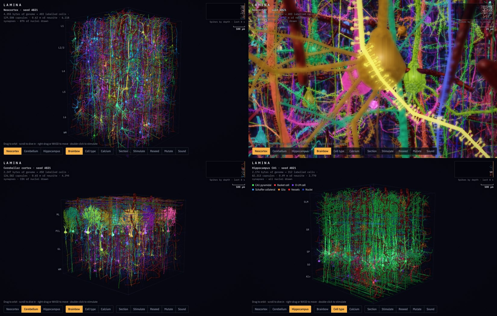

# Lamina

**A tissue genome: a few kilobytes of rules that grow a block of brain tissue, in one 39 kB HTML file.**



Where [Neuropil](../) re-dressed an ocean, Lamina starts from how tissue is actually organised. A genome is a table
of layers and a list of cell types; each cell type carries a short set of growth numbers. One grammar reads any
genome and grows the block, wires a circuit through it, and runs it.

Open [`index.html`](index.html) in any browser with WebGL 2. It works offline, on a phone too.

## What the genome encodes

| Gene | What it does |
|---|---|
| Layers | Name, thickness, cell density and fibre grain, from the pia down. Nuclei are scattered at each layer's density and a felt of unlabelled fibres runs the way that layer's fibres run, so the lamination appears on its own. |
| Arbor genes | Each neurite is grown tip by tip: step, tortuosity, tropism toward the pia or the white matter, chance of branching per micron, flatness. |
| Rall's 3/2 law | At every branch the parent's calibre is shared so that r³ᐟ² is conserved. An even split gives a fork; 86:14 gives a trunk with a twig. |
| Tufts | What a tip turns into at a given depth: an apical tuft in layer 1, a T-junction into parallel fibres, an axon turning into the alveus. |
| Connection rules | Who synapses on whom, how strongly, and how far, with separate reach along x and z. |

Three genomes ship, 2 to 4 kB each as JSON:

- **Neocortex**: L2/3, L5 and L6 pyramidal cells, L4 spiny stellates, basket and Martinotti cells, thalamic afferents, astrocytes with endfeet on capillaries.
- **Cerebellar cortex**: Purkinje fans in one shared plane, granule cells whose axons rise and split into parallel fibres at right angles to the fans, molecular layer interneurons, Golgi cells, mossy fibres, Bergmann glia.
- **Hippocampus CA1**: a dense pyramidal layer, basket and O-LM cells, Schaffer collaterals crossing stratum radiatum.

**Mutate** nudges the growth numbers by up to 30% and regrows, so you can see genotype change phenotype.
**Reseed** keeps the genome and changes the dice. The address keeps both, for example `#cerebellum-4821-m287`.

## The circuit

Every labelled cell fires as a Poisson process. Its rate is a normalization equation: excitatory drive squared,
divided by itself plus a suppressive pool fed by the inhibitory cells, with adaptation to end bursts. Spikes travel
out along each cell's own dendrites and axon by path length, and arrive at targets after a distance-dependent delay.

**Stimulate** (double-click, double-tap or space) fires a volley in the input fibres around the point you are
looking at. In the neocortex genome the test run shows the response stepping through thalamic afferents, L4, L2/3,
then L5. The raster at top right plots spikes by depth.

## Looking

| | |
|---|---|
| Orbit, dive | Drag; scroll or pinch |
| Move | Right-drag, two fingers, or `W` `A` `S` `D` `Q` `E` |
| Genomes | `1` `2` `3` |
| Colours | `C`: Brainbow, cell type, calcium |
| Optical section | `X`: a thin focal plane at the orbit centre, like a two-photon frame; scroll to focus through |
| Reseed, mutate, sound | `R`, `G`, `M` |

Every element is a capsule that the shader turns into a lit tube with its own depth and a procedural surface:
streaks along neurites, granules on somata, boutons swelling the axons, red cells moving under vessel walls.
Nuclei and the fibre felt are added as light. A second pass adds glow, depth of field focused on the orbit centre,
and a soft shadow behind whatever stands in front. Spines appear when you get close. No textures or models are
loaded; all of it is computed.

## What is and is not real

Sizes are in microns and the scale bar is true at the orbit centre. Layer thicknesses, cell densities and
morphologies are textbook-shaped approximations, not fits to data. Only a few hundred cells are labelled, as in sparse
labelling; the nuclei show the rest. Capillary length is about a third of real tissue. Time is slowed several
hundred-fold so conduction is visible. The circuit is a toy: it reproduces the order of activation, not physiology.

## Build and test

```bash
npm install
npm run build   # src/ → index.html
npm test        # counts for each genome, firing rates at rest and after a stimulus
```

`src/genome.js` is the DNA and the place to start. `grow.js` is the grammar, `net.js` the circuit, `gl.js` the
renderer, `audio.js` the sound.
